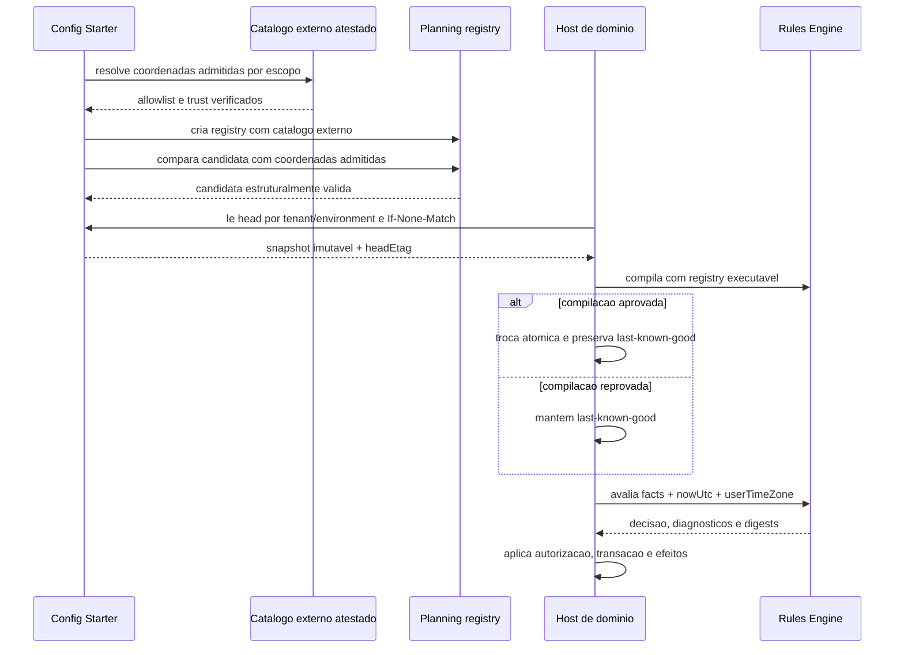

# Guia de integracao de host

## Fluxo canonico

O host resolve facts, fornece executores Java puros, compila uma definicao imutavel e avalia um plano deterministico. O engine nao le banco, nao consulta relogio do processo e nao aplica writes.



```java
RuleBindingExecutorRegistry registry = new RuleBindingExecutorRegistry(List.of(
        new EligibilityExecutor()));

RuleDecisionPlan plan = new PraxisRulePlanCompiler(registry).compile(definition);
RuleEvaluationResult result = new PraxisRuleSetEngine(registry)
        .evaluate(plan, facts, nowUtc, userTimeZone);
```

`facts` deve ser um snapshot JSON ja autorizado e resolvido pelo host. `nowUtc` e `userTimeZone` sao obrigatorios em toda avaliacao de RuleSet, inclusive quando a definicao atual nao usa operador temporal; nunca delegue isso ao timezone ou relogio do processo.

## Grafo ontologico de fatos (5 raizes canonicas)

Para regras de negocio (`decisionKind = BUSINESS`), o host nunca deve empacotar atributos de multiplas entidades em um saco escalar achatado (`facts.*`). Organize os dados nas cinco raizes ontologicas canonicas utilizando `PraxisFactTreeBuilder` ou `OntologicalFactTreeMapper`:

| Raiz | Metodo | Papel semantico |
| --- | --- | --- |
| `draft` | `putDraft(...)` | Estado candidato da mutacao (capturado apos hidratacao server-side). |
| `current` | `putCurrent(...)` | Estado persistido anterior em `UPDATE`/`DELETE` (ou `null` em `CREATE`). |
| `<concept>` | `putConcept(...)` / `putConceptEntity(...)` | Entidade relacionada em 1-hop resolvida por chave estrangeira, sem filtros de negocio no SQL. |
| `neighborhood` | `putNeighborhood(...)` | Agregacoes ou colecoes irmas em N-hop no mesmo escopo/tenant (ex.: sobreposicoes). |
| `context` | `putContext(...)` | Metadados congelados da execucao (`operation`, `tenantId`, parametros de contexto). |

### Modos de serializacao de datas e entidades 1-hop (`PraxisFactTreeBuilder`)

`PraxisFactTreeBuilder` suporta tres modos explicitos para `LocalDate` via `PraxisFactTreeBuilder.DateSerializationMode`:

- `ISO_8601` (padrao): serializa `LocalDate` como texto ISO (`"2026-11-02"`).
- `EPOCH_DAY`: serializa `LocalDate` como numero inteiro (`localDate.toEpochDay()`), ideal para aritmetica temporal direta em JSON Logic (`>`, `<`, `-`).
- `ISO_AND_EPOCH_DAY`: emite `<campo>` em texto ISO-8601 e acrescenta o irmao `<campo>EpochDay` numerico em objetos (inclusive `null` para propriedades `LocalDate` nulas em beans/records, preservando o shape fechado de `RuleFactSchema`).

Para entidades relacionadas em 1-hop, utilize `putConceptEntity(...)` para garantir `present`, rastrear opcionalmente `idPresentInDraft`, evitar traversal de associacoes JPA (`@ManyToOne`, `@OneToMany`, `@OneToOne`, `@ManyToMany`) e preencher defaults seguros quando a entidade estiver ausente (`entity == null`):

```java
Map<String, Object> roleDefaults = new LinkedHashMap<>();
roleDefaults.put("active", false);
roleDefaults.put("code", null);

ObjectNode facts = PraxisFactTreeBuilder.create(DateSerializationMode.ISO_AND_EPOCH_DAY)
        .putDraft(PraxisFactTreeBuilder.toScalarObjectNode(draftEntity, DateSerializationMode.ISO_AND_EPOCH_DAY))
        .putCurrent(currentEntity == null ? null : PraxisFactTreeBuilder.toScalarObjectNode(currentEntity, DateSerializationMode.ISO_AND_EPOCH_DAY))
        .putConceptEntity("role", roleEntity, draftEntity.getRoleId() != null, roleDefaults)
        .putNeighborhood(Map.of("overlaps", overlapCount))
        .putContext(Map.of("operation", "CREATE", "tenantId", tenantId))
        .build();
```

### Mapeamento stateless com `OntologicalFactTreeMapper`

Para provedores de fatos (`*Facts`) compartilhados como singletons stateless e thread-safe em hosts Spring, `OntologicalFactTreeMapper` padroniza a construcao das 5 raizes com validacao contra `JsonLogicLimits` e projecao segura de entidades:

```java
OntologicalFactTreeMapper mapper = OntologicalFactTreeMapper.epochDay();

ObjectNode facts = mapper.mapFiveRoots(
        draftEntity,
        currentEntity,
        Map.of(
                "role", ConceptBinding.of(roleEntity, draft.getRoleId() != null, roleDefaults),
                "approvalDoc", ConceptBinding.absent(false, Map.of("published", false))),
        new NeighborhoodSummary(0),
        Map.of("operation", "UPDATE", "tenantId", "org-1"));
```

Tambem e possivel usar `OntologicalFactTreeMapper.buildFiveRoots(...)` diretamente de forma estatica ou `OntologicalFactTreeMapper.builder(DateSerializationMode.ISO_8601)` para montagem fluente passo a passo.

## DSL declarativa `PraxisJsonLogic` e `OntologyRuleSetBuilder`

Evite concatenar strings JSON manualmente em `*RuleSet.java`. Use `PraxisJsonLogic` para construir ASTs Jackson (`Expr` / `ObjectNode`) livres de injecao JSON, validadas por `PraxisPath` e compativeis com `PraxisFactTreeBuilder.extractReferencedRoots` e `extractReferencedFactPaths`:

```java
PraxisJsonLogic.Expr dateAndConflictRule = PraxisJsonLogic.nonDelete(
        PraxisJsonLogic.and(
                PraxisJsonLogic.conceptActive("role", "active"),
                PraxisJsonLogic.zeroConflict("overlaps"),
                PraxisJsonLogic.validDateRange("draft.startDate", "draft.endDate"),
                PraxisJsonLogic.percentRange("draft.allocationPercent"),
                PraxisJsonLogic.whenOperation("UPDATE",
                        PraxisJsonLogic.strictEq(
                                PraxisJsonLogic.draft("tenantKey"),
                                PraxisJsonLogic.current("tenantKey")))));
```

Principais recursos disponiveis em `PraxisJsonLogic`:

- **Referencias ontologicas e locais**: `var`, `draft`, `current`, `concept`, `neighborhood`, `context`, `localVar` (para iteradores `map`, `filter`, `all`, `some`, `none`, `reduce`).
- **Comparacao e logica**: `eq`, `strictEq`, `neq`, `strictNeq`, `gt`, `gte`, `lt`, `lte`, `and`, `or`, `not`, `in`, `inValues`, `contains`, `startsWith`, `endsWith`, `matches`, `isNull`, `notNull`, `isBlank`, `notBlank`.
- **Guardas e helpers de dominio**: `when`, `nonDelete`, `whenOperation`, `validDateRange`, `conceptPresent`, `conceptActive`, `zeroConflict`, `percentRange`.
- **Iteradores e escape hatch**: `all`, `some`, `none`, `filter`, `map`, `reduce`, `ifElse`, `add`, `sub`, `mul`, `div`, `op(operator, args...)`.

### Composicao declarativa com `OntologyRuleSetBuilder`

`OntologyRuleSetBuilder` aceita diretamente strings JSON, `JsonNode` ou `PraxisJsonLogic.Expr` tanto em `Rule` quanto em `binding(...)` e nas fabricas de templates:

- **Estagio explicito opcional**: `Rule` aceita `DecisionStage` opcional (`withStage(DecisionStage)` ou construtor de 8 argumentos); quando `null`, regras `FORBIDDEN` usam `PROTECTED_GUARD` e regras customizaveis ou `CUSTOMER` usam `DOMAIN_DECISION`.
- **Multiplas regras `CUSTOMER` e bundle de catalogos**: `definition(..., List<Rule> product, List<Rule> customerRules, boolean includeCustomerBindings, Map<String, RuleParameterTemplate> templates)` suporta N regras de cliente em slots `MULTIPLE` (`RESTRICT_ONLY` / `DENY_OVERRIDES`). Use `definitionWithCatalog(...)` (ou `withCustomerErrorDescriptors(...)` / `withProductAndCustomerErrorDescriptors(...)`) para anexar automaticamente os `errorDescriptors` de cliente na `RuleSetDefinition` e obter `RuleSetCatalogBundle` (`productCatalog` exclusivo de produto para `RuleSetProductAdmissionVerifier` e `combinedCatalog`).
- **Templates paramétricos tipados e valores genericos**: `integerTemplate`, `decimalTemplate` (`RuleParameterType.NUMBER`), `stringTemplate` (`RuleParameterType.STRING` com enumeracao opcional) e `booleanTemplate` (`RuleParameterType.BOOLEAN`), acompanhados de `parameterizeValues(base, Map<String, ?>)`.
- **Path-level inference**: finalize a composicao com `OntologyRuleSetBuilder.requireReferencedFactPaths(...)` para derivar `availableRoots` e `requiredFactPaths` exatos da AST.

```java
Rule guard = new Rule(
        "WF-09001",
        "code",
        "Codigo da carreira e obrigatorio.",
        "PKG_CAREERS.VALIDATE",
        "Validacao estrutural de codigo",
        PraxisJsonLogic.notBlank(PraxisJsonLogic.draft("code")));

Rule parameterizedRule = new Rule(
        "WF-09002",
        "rate",
        "Percentual abaixo do minimo permitido.",
        "PKG_CAREERS.RATE",
        "Percentual minimo parametrizavel",
        PraxisJsonLogic.gte(PraxisJsonLogic.draft("rate"), new BigDecimal("1.50")),
        OverridePolicy.PARAMETERIZABLE,
        DecisionStage.POST_DECISION);

RuleParameterTemplate rateTemplate = OntologyRuleSetBuilder.decimalTemplate(
        "WF-09002",
        PraxisJsonLogic.gte(PraxisJsonLogic.draft("rate"), new BigDecimal("1.50")),
        "careers:min-rate",
        "minRate",
        new BigDecimal("1.50"),
        new BigDecimal("0.50"),
        new BigDecimal("10.00"),
        "/>=/1",
        "percentual");

RuleSetCatalogBundle bundle = OntologyRuleSetBuilder.definitionWithCatalog(
        new RuleSetRef("workforce.core", "administracao-pessoal.workforce", "workforce.careers", "create", 1),
        "careers.create",
        "customer.org2.",
        List.of(guard, parameterizedRule),
        List.of(customerRule1, customerRule2),
        true,
        Map.of("WF-09002", rateTemplate));

RuleSetDefinition readyDefinition = OntologyRuleSetBuilder.requireReferencedFactPaths(
        OntologyRuleSetBuilder.parameterizeValues(
                bundle.definition(),
                Map.of("WF-09002", new BigDecimal("2.25"))));
```

## Catalogos de fatos e enriquecimento de DTOs

A admissao tipada por operacao separa a validacao estrutural pura do enriquecimento de metadados de API:

- **`RuleFactCatalogLoader` e `RuleFactSchema` (`praxis-rules-engine`)**: compilam o documento `praxis.domain-rule-fact-catalog.v2`, validam tipos fechados, limites e sensibilidades (`NON_SENSITIVE`, `SENSITIVE`, `SECRET`), e produzem `RuleFactContract` por operacao para `PraxisRuleSnapshotCompiler.compileForOperation(...)`. Veja o [ADR-15](p2f-adr-15-typed-fact-admission.md).
- **`DtoMetadataFactCatalogEnricher` (`praxis-metadata-starter`)**: executado no host/starter Spring, introspeciona os DTOs de escrita e resposta do recurso (`@Schema`, `@UISchema`, `@DomainGovernance`, incluindo `record`s e herancas de dados) para enriquecer labels, descricoes e governanca sem acoplar o `praxis-rules-engine` a frameworks HTTP ou OpenAPI.

## Calculadoras parametricas puras

O pacote `org.praxisplatform.rules.parametric` concentra algebras puras em `java.time` e `BigDecimal` com memoria de calculo auditavel (`TrailStep` / `FinancialTrailStep`), evitando duplicacao de regras em servicos imperativos do host:

| Componente | Responsabilidade principal |
| --- | --- |
| `EffectiveDatedIntervalCalculator` | Contagem liquida de intersticios, aquisicoes e prescricoes com `SUSPEND` (coalescencia de janelas sobrepostas/adjacentes sem dupla contagem), `INTERRUPT_AND_RESTART`, `IGNORE`, `BonusAddition` com teto e projecao de data-alvo. |
| `ProgressiveBracketAndCapCalculator` | Calculo progressivo (`MARGINAL_SLICES` com teto de base opcional e `TABLE_RATE_MINUS_DEDUCTION`), abate-teto preservando parcelas indenizatorias, margem consignavel, reconciliacao liquida e `pro-rata` (`HALF_UP`). |
| `EffectiveDatedBracketTable` | Tabelas progressivas e tetos versionados por vigencia `[validFrom, validTo]` (`BracketScheduleEpoch`, rejeitando sobreposicoes na criacao). Em recalculos retroativos, resolva sempre pela **data do fato gerador/competencia de direito** antes da data de processamento do lote. |
| `EffectiveDatedMatrixMatcher<T>` | Selecao deterministica multi-criterio com desempate estavel e rejeicao fail-closed de empates ambiguos. |
| `TriStateOverrideResolver` | Precedencia `PERMITIR` / `VEDAR` / `HERDAR` (`S`/`N`/`I`) preservando `0` e `false` explicitos em overrides numericos. |

Consulte tambem o [template governado, captura de fatos e resolucao parametrica](governed-rule-template.md) para detalhes de cache local por escopo e tratamento de `PraxisRuleViolationException`.

## Executores Java

Um executor e puro, namespaced e versionado de forma exata:

```java
final class EligibilityExecutor implements RuleBindingExecutor {
    public String implementationKey() { return "benefits:eligibility"; }
    public String implementationVersion() { return "1.0.0"; }
    public RuleExecutorResult evaluate(RuleExecutorContext context) {
        return RuleExecutorResult.allow();
    }
}
```

Executores nao podem realizar I/O ou efeitos. Um binding persistido referencia a chave e a versao exatas; a compatibilidade e verificada no planejamento e novamente na avaliacao.

## Resultado e acao do host

| Decisao | Significado | Acao do host |
| --- | --- | --- |
| `ALLOW` | Decisao terminal permitiu a operacao | Pode continuar para a politica/autorizacao do host. |
| `DENY` | Regra de negocio negou | Exponha a negativa de negocio e os reason codes permitidos. |
| `NOT_APPLICABLE` | Nenhuma decisao terminal se aplica | Nao trate como `ALLOW` sem politica explicita do caso de uso. |
| `INCONCLUSIVE` | Facts ou pre-condicoes insuficientes | Resolva facts ou siga a `RuleFailPolicy` no host. |
| `TECHNICAL_ERROR` | Falha de runtime, limite ou executor | Registre de forma segura; nunca a converta em negativa de negocio. |

Use `planDigest`, `factsDigest`, `compatibility` e `implementationRefs` para correlacao/auditoria. Facts e outputs nao devem ser gravados automaticamente pelo engine.

## Snapshots governados

O Config Starter publica `PublishedRuleSnapshot`; o host deve compilar a candidata fora do caminho de requisicao e trocar a referencia ativa apenas quando a compilacao for bem-sucedida:

```java
CompiledRuleSnapshot prepared = new PraxisRuleSnapshotCompiler(registry)
        .compile(snapshot, "my-domain-host/1.0");
// O host realiza aqui a troca atomica da referencia ativa e preserva last-known-good.
```

O control plane pode usar `RuleBindingExecutorRegistry.planning(declarations)` para provar coordenadas permitidas sem instanciar codigo do host. Esse registry nao executa bindings Java; somente o host fornece o registry executavel.

Head ETag, ativacao, rollback, cache e persistencia pertencem ao Config Starter/host. Um rollback para o mesmo conteudo precisa de nova identidade de ativacao no control plane; o hash de conteudo permanece estavel.

## Composição de cálculos Java (contract 1.5)

Declare a aresta em `dependsOn` e, na admissão do plano compilado, confira
`plan.directDependencyOutputKeys(consumerKey)` para a aresta requerida. O host
valida o shape tipado de `context.directDependencyOutputs().get(producerKey)`;
chave ausente, null inesperado ou unidade/escala inválida são falhas técnicas
do contrato do host. Não pré-preencha resultado intermediário em facts nem
execute novamente fora do DAG. Não use `requiredFactPaths` para pseudo-paths
de outputs. O [ADR-14](p2f-adr-14-direct-dependency-outputs.md) define a política
fixa de fontes/stages, isolamento e budgets. A consulta não concede acesso a
outputs de segurança, cliente ou intents, mesmo com assinatura attestada.

Adote somente coordenada Maven publicada e replique aprovação/compilação de
composições compatíveis 1.5 no control plane e host. Engine 1.5 rejeita 1.4;
leitura histórica e coreografia de cutover pertencem ao control plane/host.

Em hosts corporativos, cacheie apenas planos compilados com a tupla atual de
engine/dialeto/corpus e registry compatível. Restauração de um record público
não equivale a admissão; o evaluator recusa coordenadas incompatíveis, mas não
substitui a verificação de conteúdo, tenant/ambiente, autorização e aprovação.
A captura única de facts protege a avaliação contra alterações posteriores no
draft do chamador; forneça a árvore estável enquanto a captura acontece.

O canal interno restrito não autoriza exposição de salários: o host projeta
somente campos autorizados e nunca serializa `RuleEvaluationResult` bruto como
resposta genérica ao navegador. Diagnóstico técnico não é negativa de negócio.
A versão publicada, a autoridade ativa e a identidade da folha devem continuar
verificáveis pelo fluxo canônico antes de qualquer persistência.
